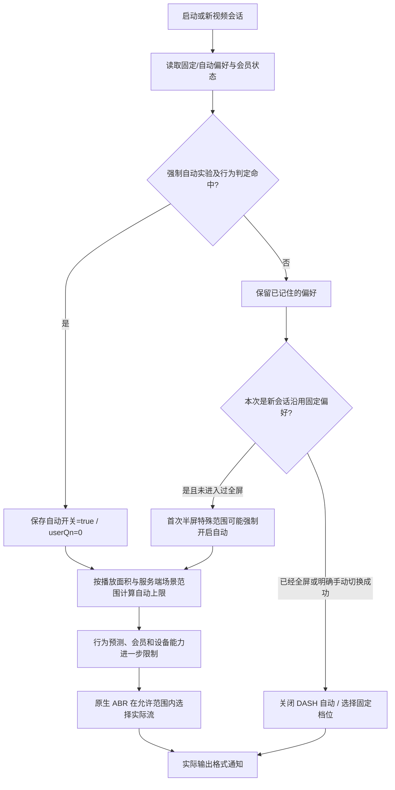

# 原版 B 站 Android 画质策略调查（2026-10-19）

调查对象为连接真机上的官方粉版 `tv.danmaku.bili 9.15.0 / 9150300`，设备 HONOR NTH-AN00、Android 14、1080×2340，使用现有登录状态和 Wi-Fi。结论来自本机 APK 静态分析及连续 Codec 输出日志，不外推到网页、iOS、HD、国际版或全部服务端实验人群。

**本轮结论**

官方 Android 客户端确实存在用户没有在当前画质菜单里显式选择的画质限制路径：记住的固定画质可以在新视频会话的首次半屏阶段改走自动范围；启动时还存在由实验开关和行为模型决定的“把固定偏好重置为自动”分支。它不是一条“手选 4K 后，无论是否全屏都固定偷降到 1080P60”的统一规则。

在这台手机、本版本、本片源的有效采样里，**明确重新选择 4K 后的全屏稳态保持 3840×2160**；全屏→半屏→全屏、长按倍速、拖动进度的采样窗口内也未观察到持续降低输出尺寸。**重新打开视频、从未进入全屏的半屏会话则实际输出 1920×1080，Codec 送显约 30/s；首次进入全屏后约 3–4 秒升至 3840×2160。** 因此，应区分“沿用上次记住的 4K”和“当前会话刚刚手动切至 4K”。

同时查到一个足以误导此前研究的采集问题：解码器的初始配置、厂商历史记录及部分 `media.metrics` 条目不是当前流格式。同一 Codec 创建时登记 1920×1080，之后可以实际输出 3840×2160；创建记录仍不更新。仅凭这些记录，不能证明全屏实际停留在 1080P，更不能确定为 1080P60。

**测量方法与证据优先级**

本轮先绑定包名、PID、Codec 会话和操作时间，再读取 `CCodecBuffers` 的 `output format changed` 块及对应 `crop`。例如 `crop(0,0,3839,2159)` 对应 3840×2160。Android 官方文档说明尺寸变化会产生输出格式变化事件，后续输出应按新格式解释，裁剪框的右/下端点须加一。参见 [MediaCodec 输出格式及裁剪规则](https://developer.android.com/reference/android/media/MediaCodec#INFO_OUTPUT_FORMAT_CHANGED)。

`media.hncodec` 中的 `size: 1920x1080, frameRate:30`、`CCodec` 配置阶段的尺寸/帧率、任意一条已结束会话的 `media.metrics`、全屏 Surface 的 2340×1080、画质菜单文字，都不独立作为当前片源格式的判据。`CCodecConfig` 在 flush/重建时还可能短暂回到初始值，必须继续追踪随后输出块。

帧率对照使用同一 Codec 的持续 `TraceLog Rendered/Discarded` 计数；这是 Codec 释放输出次数，不是屏幕实际呈现 FPS。1080P60 窗口送显中位数 60.0/s、1080P 和 720P 窗口 30.0/s，三窗丢弃中位数均为 0。未从初始化 `frameRate:30` 推断所有片源都是 30fps。

测试期间主要窗口系统 `Thermal Status:2`，USB 连接、温度/电量随时间变化，没有 ABBA 性能设计。本轮只比较选流和格式行为，不据此比较功耗、解码性能、掉帧收益，也不将 4K 下的输出速率当作稳定屏幕帧率。

**有效实测矩阵**

核心片源为 [已然统治极限战场，BV1tmJz6GER1](https://www.bilibili.com/video/BV1tmJz6GER1/)，画质菜单提供 4K、1080P60、1080P、720P、480P、360P。此前性能主对照的 M417 / BV1a2pr6aEC1 当前菜单与公开接口最高为 1080P60，不能拿它检验 4K 降档。

| 操作/场景 | 实际输出与持续观察 | 本轮判断 |
| --- | --- | --- |
| 全屏明确选 4K | 19:47:40.355 选择，19:47:44.631 输出变为 3840×2160；约 32 秒采样维持 | 未复现全屏持续降至 1080P |
| 上述会话退出至半屏 | 连续约 27 秒没有更低尺寸的输出格式事件 | 已进入过全屏后，退出半屏不等于新会话首次半屏 |
| 再回全屏 | 连续约 27 秒仍无更低尺寸事件，截图仍为同片源/4K | 保持 4K |
| 全屏选 1080P60 | 1920×1080，稳定窗口 Codec 送显中位数 60.0/s | 与所选档位一致 |
| 全屏选普通 1080P | 1920×1080，稳定窗口送显中位数 30.0/s | 分辨率相同但负载不同，不能与 1080P60 混比 |
| 全屏选 720P | 1280×720，稳定窗口送显中位数 30.0/s | 与所选档位一致 |
| 全屏选 480P | 852×480，约 18 秒观察 | 与所选档位一致 |
| 全屏选 360P | 640×360，约 18 秒观察 | 与所选档位一致 |
| 选择“自动”后全屏 | 1920×1080，采样窗口送显中位数约 30.0/s | 自动未选择可用的最高 4K |
| 同一自动会话退半屏/再全屏 | 各约 27 秒，未出现新的更低尺寸事件 | 本轮没有观察到每次缩小播放器必然降档 |
| 已记住 4K，停止进程后重新打开视频，首次半屏 | 19:57:04.551 输出 1920×1080，持续到首次全屏；19:57:10–32 送显中位数 30.0/s、丢弃中位数 0 | 复现首次半屏隐式降低实际输出 |
| 上述新会话第一次全屏 | 19:57:39.206 输出升至 3840×2160，之后约 27 秒仍为 4K | 本机是恢复 4K，并非全屏固定限 1080P |
| 手选 4K 后长按倍速约 10 秒，松手后继续采样 | 倍速提示截图已保存，没有更低尺寸输出事件 | 此窗口未复现倍速导致降分辨率；未据此断言零掉帧 |
| 手选 4K 后拖动进度 | flush 配置曾出现 1080P 初始值，随后有效输出块为 3840×2160 | 不把 flush 的配置回退误判为已降流 |

额外做过 HOME 后通过视频深链返回。该操作新建/重开了半屏播放页，并创建新的 Codec，实际重新从 1080P 起播；它不满足“原页面直接恢复”的对照条件，不能据此宣称普通后台返回会让全屏暗降。初期还发生过自动连播进入下一条视频，其 1080P 日志已从原视频降档证据中排除。有效矩阵期间临时关闭自动连播，结束后恢复。

**决策链：先确定偏好，再决定是否允许自动选流**



该图概括普通在线视频路径，不替代 HDR 优先、试看片源、共享播放器与缓存文件的特殊分支。图中“可能强制”指代码路径存在，并非所有用户的服务端范围和开关相同。

**首次半屏和全屏记忆：不仅看当前横竖屏**

`QualityStrategyProvider` 为每个媒体会话维护 `hasFullscreen`。初始取当前是否全屏；一旦观察到全屏就置为 true，返回半屏不清零。首次半屏的 `specialQualityHalfRangeFlow` 可以是有限范围；已全屏后变为 `Integer.MAX_VALUE..Integer.MAX_VALUE` 这个取消限制的哨兵值。

`PCSFacadeImpl$withSpecificQualityPreference$2$runCore$1` 在上限是有效有限画质时，日志文字就是 `force auto quality specifiedQuality...`，随后调用 `setDashAuto(true,min,max)`；当特殊范围变为取消限制的哨兵值时，重新应用指定的固定画质。另有 HDR/试看等优先画质路径可跳过这条特殊范围收集，不能把普通 SDR 的结果套给它们。

当前会话收到显式的固定画质选择后，`PCSFacadeImpl.J` 先调用 `setDashAuto(false,...)`，再切到指定档位。切换成功后取消旧范围监听协程、转入新的偏好状态。因此“上次选过 4K，重新打开时沿用它”和“此刻重新选中 4K”是两种不同的触发入口。

已下载/缓存和共享播放器还有单独分支。例如缓存资源会获得无有限上限的范围；某些共享起播阶段先用 0..0 占位、等待后续资源更新。这些分支只做静态核对，本轮没有下载/共享播放器的完整实测矩阵。

**播放面积阈值：并不等同于一个全屏按钮**

`Jl.a` 的场景判定是：

```text
ratio = 播放区域宽 × 播放区域高 / (屏幕宽 × 屏幕高)
ratio <= threshold → LOW_RATIO
ratio > threshold  → HIGH_RATIO
```

`AutoQualityRange` 的默认阈值为 0.5。范围由服务端 `auto_qn_ctl.scene_qn_range.high_ratio/low_ratio` 和 `qn_exp` 提供；解析还涉及 `qn_exp_3`、策略 ID 等。没有有效范围时，部分通用回退为低面积 qn32..64、高面积 qn32..116；Theseus 在缺省分支还根据登录状态和页面状态，可能给低面积上限 32、64 或 80。**这些是代码回退值，不是本机当前服务端下发值。** 本机首次半屏实际达到 1080P，也说明不能机械地套用“所有半屏最多 720P”。

自动范围的客户端状态还保留已经达到的较高上限：当前这版 `QualityStrategyProvider.c` 中，新的自动上限没有高于现有值就不会替换它。因此从未放大的小窗、刚进入过大窗再缩小、重开新视频会话，需要分别采样，不能只做横屏/竖屏两个静态截图。

分屏、小窗、竖版视频、播放器容器和真实显示区域都可能影响面积输入；它们没有在本轮全部实测。半屏/全屏状态也被额外作为 `screenState` 送入 IJK：HALF=0、FULL=1、STORY=2、MINI=3。面积场景和该状态是两条不同输入。

**画质范围如何受到用户、会员和设备影响**

`iu1.i.a` 先选高/低面积范围，再把 avid、初始上限、播放器短边、面积场景和是否 Wi-Fi 交给 `VideoQualityPredictor`，取预测结果覆盖上限。可见的输入包括：

| 因素 | 已还原的行为 | 证据边界 |
| --- | --- | --- |
| Wi-Fi / 移动网络 | 预测输入区分网络，历史用户偏好也分别保留；原生有用户播放偏好参数 | 本机无 SIM，未跑移动网络/切网/弱网矩阵 |
| 高画质/省流偏好及历史选择 | 高/低/普通标签、最近手动切换方向及比例、LSTM 预测结果影响范围 | 是实验配置下的预测路径，不是每个固定画质选择都会经过 |
| 片源/UP 主因素 | 素材特征、本人投稿识别可以给出高画质标签 | 本轮只实测一条 4K SDR 片源 |
| 会员 | 非有效会员等条件会限制预测上限；启动 userQn 也会按权限钳制 | 本轮未切换账号或会员状态 |
| 设备能力 | 设备支持 qn、设备特征及设备黑名单参与上限预测 | 这台手机已实际输出 4K，不能据屏幕是 1080P 断言不支持解码 4K |
| 播放区域短边 | 特定设备/平台条件和实验开关满足时有独立短边分档，并可能限制原本预测的 4K | 不能将该条件表当作所有 Android 设备的固定限制 |
| 低峰计费时段 | `bp.vq.off_peak_billing_period` 命中且设备非低画质标签时，可提高低/高面积的候选上限 | 只有代码分支证据，未读到本机开关值 |
| HDR 优先/试看 | 优先画质集合和试看路径可绕开普通半屏特殊范围 | 未跑 HDR/Dolby Vision/HDR Vivid 的画质对照 |
| 温控/省电/解码压力 | `AbrParamsInterface` 存在低功耗、高体验等原生参数接口 | 接口存在不等于本机命中；没有确认“温度到某值就强降某档”的完整阈值链 |

短边表在相应前置条件成立时为 `<=900→64`、`<=1080→80`、`<=1350→112`、`<=1620→116`、更大→120，还会考虑是否等于屏幕宽度。实验 `bp.vq.opt`、设备特征和后续钳制会影响其适用性。qn64/80/112/116/120 通常对应 720P/1080P/高码率1080P/1080P60/4K 档位，不能用 qn 数字替代实际 width、height、frame rate、codec；例如 qn112 不是“2K”。

可核对的代码默认值包括 `bp.video_quality_enable=false`、`bp.video.default_quality_max_qn=80`、`bp.video.default_quality_max_qn_small=64`、`bp.vq.limit_screen_qn=116`。它们说明控制面有哪些参数，**不说明本机实际远端配置就是这些值**。

**启动时把固定画质偏好重置为自动的实验**

`Dt1.a.bootInProcess`（PlayerBootstrapUtils）在主进程启动时读取：

```text
ff_player_ai_force_auto
ff_player_ai_repeat_force_auto
pref_player_quality_has_reset_auto_v2
```

大体门槛为强制自动实验开启，且允许重复执行或以前尚未执行；再由行为预测引擎 `shouldForceAuto` 的结果决定是否实际重置。相关配置还有 `bp.video_quality_enable`、`bp.auto_tendency_v3_enable`、`bp.auto_tendency_v4_enable`。决策对象包含候选置信度、历史切换、会员/非会员冷却天数、上次强制自动时间等字段，不能简化为“只要付费会员就会重置”或“每次启动必定重置”。

命中后的可见写入是：

```text
pref_player_mediaSource_quality_auto_switch = true
ABRManagerKt.setUserQn(0)
pref_player_quality_has_reset_auto_v2 = true
```

这是一条确实会覆盖既有偏好的路径。代码片段中没有与上述写入配套的即时确认弹窗调用；但未审完全部可能的外层提示，也未取得本机实验配置/运行时命中日志，因此不能声称本机这次执行了重置，或所有用户都完全没有其他提示。

**界面标签、实际输出与原生 ABR 的边界**

播放器分别保存画质偏好、实际画质通知和当前资源/输出格式。画质按钮又受 `ff_auto_qn_show_real_quality` 等界面实验控制，自动模式可以只显示“自动”，也可以显示实际档位相关信息。菜单中的高亮、控制栏标签、正在切换的流及已经输出的帧不保证在切换的每一毫秒一致。

原生侧 `AbrParamsInterface` 明确接收最低 qn、最高 qn、用户 qn、用户播放偏好、屏幕场景、低功耗/高体验参数，并加载远端 `ijkplayer.abr_param`。Java/Kotlin 调用链及接口已还原；**native ABR 的完整实时决策、全部缓冲/吞吐阈值、服务器实验分组和所有异常回退分支尚未完整反向还原**。没有实际配置及针对性实验，就不能给出可靠的“带宽低于 X 连续 Y 秒一定降到 Z”表。

本轮没有抓取/解密应用的账户凭据，没有安装证书、修改官方 APK、root 或注入官方进程。2K/8K/HDR/杜比、低电量开关、无会员、不同 SoC、移动网络与受控弱网尚未完成真机覆盖。它们应列为未测范围，不能从这条 SDR 视频推成统一结论。

**对之前性能判断的修正**

在判断“官方 4K 比第三方更流畅/省电”之前，至少需要同时匹配：同一视频及区间、实际流档位/尺寸/编码/帧率、播放倍率、全屏历史、自动/固定模式、稳定输出窗口和热状态。1080P30、1080P60、4K 的菜单/初始 Codec 记录不能混用。

此前若只有“已点 4K + 全屏截图 + 某条 1920×1080 创建或历史记录”，结论应改为“尚不能确定采样窗口实际流”，不能继续当作官方已在全屏持续隐降的确定证据。本轮证实了首次半屏的隐式低档输出及启动强制自动实验的存在，同时也证实这台设备在明确选择后能够输出真 4K。

本结论不撤销 PiliExo 已通过手测的播放修复，也不重新解释此前尚未量测清楚的约 0.5W 功耗差值。

**原始证据与复核入口**

本机忽略目录：`tools/diagnostics/bili-quality-20261019/`。官方 APK 为 220,423,137 字节，SHA-256：

```text
50912ade282e9fde3effe0601018c28cd35d3d2eb923a498b42ee11b1b323f41
```

- `matrix-events.jsonl`：逐项操作和截图时间，全部北京时间。
- `matrix-manual4k-logcat.txt`、`matrix-lower-logcat.txt`、`matrix-auto-logcat.txt`、`matrix-low-logcat.txt`：受控连续采集。
- `cold-logcat.txt`：新会话首次半屏→首次全屏，PID6012；决定性输出事件 19:57:04.551 / 19:57:39.206。
- `matrix-edges-logcat.txt`：倍速、seek 和通过深链重开半屏页的附加实验；后者明确不当作普通后台恢复实验。
- `controlled-*`、`cold-*`、`edges-*`：截图与厂商 Codec 初始记录、热状态等快照。
- `targeted/`：JADX1.5.6 定向反编译；文件名附加 raw class name 哈希，避免混淆名大小写在 Windows 上相互覆盖。
- `specific-simple.java`：复杂协程方法的线性指令复核，避免把 JADX 的区域重建失败当作原程序逻辑。
- `evidence-summary.json`、`evidence-manifest.json`：提取出的输出尺寸事件、送显统计、关键源文件定位及逐文件 SHA-256。

关键原类：`com.bilibili.ship.theseus.united.player.c/d`、`QualityStrategyProvider$rangeQualityStrategy$1/2`、`com.bilibili.player.tangram.playercore.PCSFacadeImpl` 及固定画质协程、`Jl.a`、`iu1.i`、`kntr.common.behavior.prediction.predictor.VideoQualityPredictor/C`、`Dt1.a/h`、`tv.danmaku.ijk.media.player.AbrParamsInterface`、`tv.danmaku.videoplayer.coreV2.adapter.ijk.IjkMediaPlayAdapter`。

公开旁证：[BiliRoamingX 的 VideoQualityPatch](https://raw.githubusercontent.com/BiliRoamingX/BiliRoamingX/main/integrations/app/src/main/java/app/revanced/bilibili/patches/VideoQualityPatch.java) 分别处理半屏、Wi-Fi 全屏和移动网络全屏偏好；它只能佐证有不同入口，不用于替代本机 9.15.0 的分支分析。

本轮只新增调查材料和研究脚本，未修改 PiliExo 播放实现、版本或发布。官方 App 的自动连播已恢复开启，临时充电常亮恢复为原值 0；最终停止官方 App 并息屏。未构建、未安装替换包、未提交推送、未触发 GitHub Actions。

**2026-10-19 20:54 倍速机制补充**

长按流畅度需结合实际倍率与帧丢弃审查。后续原生分析查到fps>=50等路径把请求倍率钳至2倍，并有动态operating-rate、解码前非参考包跳过、解码输出阶段丢帧。补测同时记录到约2406ms输出间隔，不能宣称官方始终不卡。完整调用链、实验组与证据限制见[原版B站长按倍速逻辑调查-2026-10-19.md](原版B站长按倍速逻辑调查-2026-10-19.md)。本补充不改PiliExo实现。
